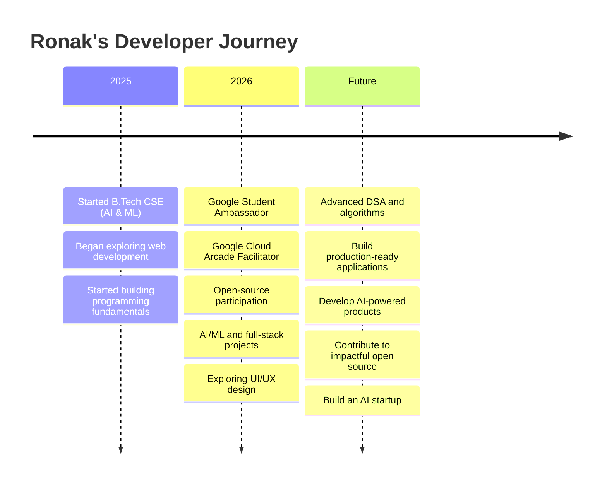

 

# 👋 Hey, I'm Ronak Sharma!

### `CSE (AI & ML) @ UIET MDU Rohtak`

**Building intelligent products. Designing better experiences. Solving real-world problems.**

💻 Full-Stack Developer   •   🤖 AI/ML Explorer
🎨 UI/UX Enthusiast   •   🌐 Open-Source Contributor
☁️ Google Cloud Arcade Facilitator   •   🎓 Google Student Ambassador 2026

 

  

---

## 🧭 Navigation

[About Me](#-about-me) •
[Achievements](#-achievements--experience) •
[Tech Stack](#-tech-stack) •
[UI/UX](#-uiux-design--frontend-experience) •
[Projects](#-featured-projects) •
[Learning](#-currently-learning) •
[Analytics](#-github-analytics) •
[Journey](#-my-developer-journey) •
[Contact](#-lets-connect)

---

## 🧑‍💻 About Me

I'm a **B.Tech Computer Science student specializing in Artificial Intelligence and Machine Learning** at UIET MDU Rohtak.

I enjoy transforming ideas into practical software products, exploring intelligent systems, and creating digital experiences that combine functionality with thoughtful design.

* 🎓 Pursuing B.Tech in CSE (AI & ML) at **UIET MDU Rohtak**.
* 💻 Developing full-stack web applications and interactive interfaces.
* 🤖 Exploring artificial intelligence, machine learning, and data science.
* 🧠 Strengthening my foundations in DSA and competitive programming.
* 🎨 Interested in UI/UX design, usability, and responsive web experiences.
* 🌐 Contributing to open-source initiatives and developer communities.
* ☁️ Serving as a Google Cloud Arcade Facilitator.
* 🎓 Participating in the Google Student Ambassador 2026 program.
* 🚀 Working toward building impactful AI-powered products and startups.

> 💡 **My philosophy:** Learn → Build → Experiment → Share → Improve.

---

## 🏆 Achievements & Experience

<table>
<tr>
<td align="center" width="33%">

### ☁️

**Google Cloud**

Google Cloud Arcade Facilitator

</td>
<td align="center" width="33%">

### 🎓

**Google Student Ambassador**

2026 · Cohort I

</td>
<td align="center" width="33%">

### 🌐

**Open Source**

NSOC'26 · GSSoC'26
ECSOC'26 · OSCI'26

</td>
</tr>
</table>

### 🎓 Google Student Ambassador 2026

* Participating in campus technology initiatives and student engagement activities.
* Exploring Google AI tools and sharing technology-focused content.
* Organizing activities that encourage students to experiment with emerging technologies.
* Exploring opportunities to help peers discover AI-powered workflows.

### ☁️ Google Cloud Arcade Facilitator

* Supporting hands-on cloud learning activities.
* Exploring Google Cloud services, labs, and technical learning paths.
* Encouraging practical cloud skill development among learners.

### 🌐 Open-Source Contributions

* Participating in open-source programs and collaborative development.
* Learning through community-driven projects, code reviews, and practical implementation.
* Building projects that strengthen my software development skills.

### 🧩 Problem Solving

* Practising DSA using Python.
* Solving coding problems on LeetCode, GeeksforGeeks, and InterviewBit.
* Improving algorithmic thinking, complexity analysis, and debugging skills.

---

## 🛠️ Tech Stack

### 👨‍💻 Programming Languages

### 🎨 Frontend Development

### ⚙️ Backend & Databases

### 🤖 AI / ML & Data Science

  

### 🎨 UI/UX Design & Frontend Experience

I am interested in building interfaces that are visually consistent, intuitive, accessible, and responsive.

<table>
<tr>
<td width="50%" valign="top">

**🎯 UI Design**

* Visual hierarchy
* Typography and spacing
* Color systems
* Consistent components
* Modern interface layouts

</td>
<td width="50%" valign="top">

**🧠 UX Design**

* User-centered thinking
* Wireframing and prototyping
* Responsive layouts
* Usability considerations
* Accessibility fundamentals

</td>
</tr>
</table>

**My design workflow**

`Research` → `Wireframe` → `Prototype` → `Develop` → `Test` → `Improve`

### 🔧 Tools & Platforms

---

## 🚀 Featured Projects

Here are some projects from my development journey across web development, AI/ML, and software engineering.

<table>
<tr>
<td width="50%" valign="top">

<h3>📝 TO-DO-APP</h3>

A task management application focused on simplicity, usability, and a clean interface.

**Tech Stack**

HTML · CSS · JavaScript

**Focus Areas**

* Interactive task management
* Clean user interface
* Frontend fundamentals

</td>
<td width="50%" valign="top">

<h3>🧬 Antibiotic Resistance Prediction</h3>

A machine learning project exploring data-driven prediction of antibiotic resistance.

**Tech Stack**

Python · Machine Learning · Data Science

**Focus Areas**

* Dataset exploration
* Feature analysis
* Predictive modelling

</td>
</tr>

<tr>
<td width="50%" valign="top">

<h3>📊 AI-SaaS-Dashboard</h3>

An interactive analytics dashboard built to explore data visualization and application development.

**Tech Stack**

Python · Streamlit · Data Analytics

**Focus Areas**

* Interactive dashboards
* Data visualization
* Information presentation

</td>
<td width="50%" valign="top">

<h3>🌐 Personal Portfolio</h3>

A personal portfolio showcasing my projects, technical skills, and developer journey.

**Tech Stack**

HTML · CSS · JavaScript

**Focus Areas**

* Personal branding
* Responsive web design
* Project presentation

</td>
</tr>

<tr>
<td width="50%" valign="top">

<h3>💳 SaaS Billing Portal</h3>

A full-stack SaaS billing application developed around modern web technologies.

**Tech Stack**

MongoDB · Express · React · Node.js

**Focus Areas**

* Full-stack architecture
* Database integration
* Application workflows

</td>
<td width="50%" valign="top">

<h3>🧮 Scientific Calculator</h3>

A Python-based scientific calculator project focused on implementing mathematical operations.

**Tech Stack**

Python

**Focus Areas**

* Mathematical computation
* Programming fundamentals
* Input handling

</td>
</tr>
</table>

> 💡 **Project showcase tip:** Adding screenshots, live demos, and concise documentation to individual repositories will make these projects even more compelling.

---

## 📚 Currently Learning

I am continuously strengthening my foundations while exploring technologies that help me build better software.

<table>
<tr>
<th>Area</th>
<th>Current Focus</th>
</tr>
<tr>
<td>🧠 DSA & Algorithms</td>
<td>Problem solving, algorithm design, and complexity analysis</td>
</tr>
<tr>
<td>💻 Full-Stack Development</td>
<td>React, Node.js, APIs, databases, and application architecture</td>
</tr>
<tr>
<td>🤖 AI / Machine Learning</td>
<td>Python, data analysis, model development, and experimentation</td>
</tr>
<tr>
<td>🎨 UI/UX Design</td>
<td>Interface design, wireframes, responsive layouts, and usability</td>
</tr>
<tr>
<td>☁️ Cloud Computing</td>
<td>Google Cloud fundamentals and hands-on labs</td>
</tr>
<tr>
<td>🌐 Open Source</td>
<td>Collaborative development and community contributions</td>
</tr>
</table>

### 🎯 My Current Priorities

* Build useful, real-world full-stack applications.
* Develop stronger DSA and problem-solving skills.
* Learn to design more intuitive and accessible interfaces.
* Explore AI/ML through practical projects.
* Contribute consistently to open-source initiatives.
* Develop products that solve meaningful problems.

---

## 📊 GitHub Analytics

  

---

## 📈 Contribution Activity

---

## 🐍 Contribution Snake

> **Note:** The contribution snake requires a GitHub Actions workflow to generate and publish the SVG to the `output` branch. If the image does not appear, check that the workflow and branch are configured correctly.

---

## 🗺️ My Developer Journey

---

## 🎯 Goals for 2026

<table>
<tr>
<th>Goal</th>
<th>Status</th>
</tr>
<tr>
<td>🧠 Strengthen DSA and problem solving</td>
<td>🔄 In Progress</td>
</tr>
<tr>
<td>💻 Build full-stack applications</td>
<td>🔄 In Progress</td>
</tr>
<tr>
<td>🤖 Explore practical AI/ML projects</td>
<td>🔄 In Progress</td>
</tr>
<tr>
<td>🎨 Improve UI/UX design skills</td>
<td>🔄 In Progress</td>
</tr>
<tr>
<td>🌐 Contribute to open source</td>
<td>🔥 Active</td>
</tr>
<tr>
<td>☁️ Strengthen cloud computing skills</td>
<td>🔥 Active</td>
</tr>
<tr>
<td>🚀 Build meaningful AI-powered products</td>
<td>🎯 Ongoing Goal</td>
</tr>
</table>

---

## 🤝 Let's Connect

I'm always interested in connecting with developers, designers, students, and builders who enjoy learning and creating useful products.

 

  

### 💡 Have an idea? Let's build it.

**Open to collaborations · Open Source · Hackathons · AI Projects**

 

⭐ If you find my work interesting, consider starring my repositories!

 

### Building. Learning. Experimenting. Growing. 🚀

*Always curious. Always creating.*

......
